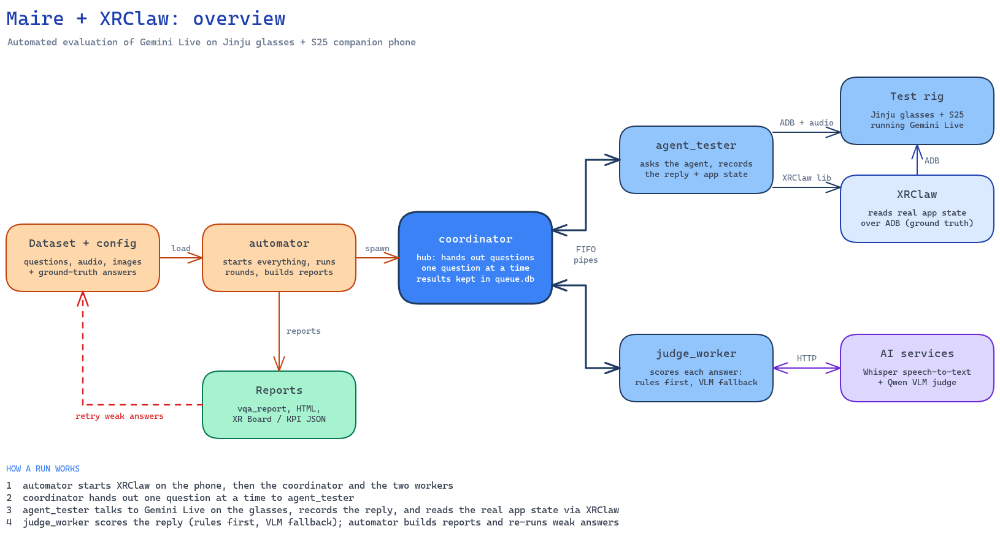
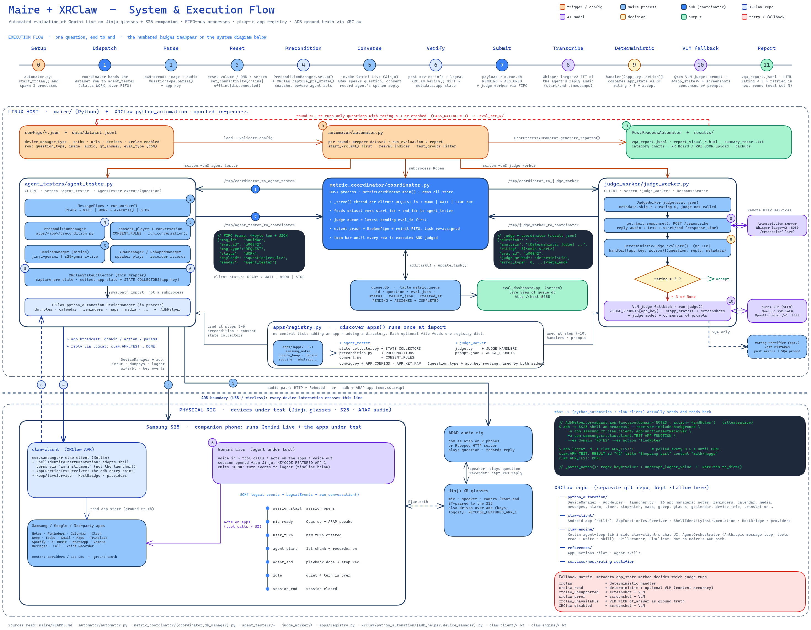
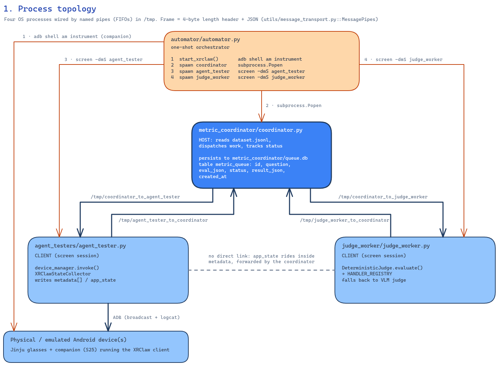
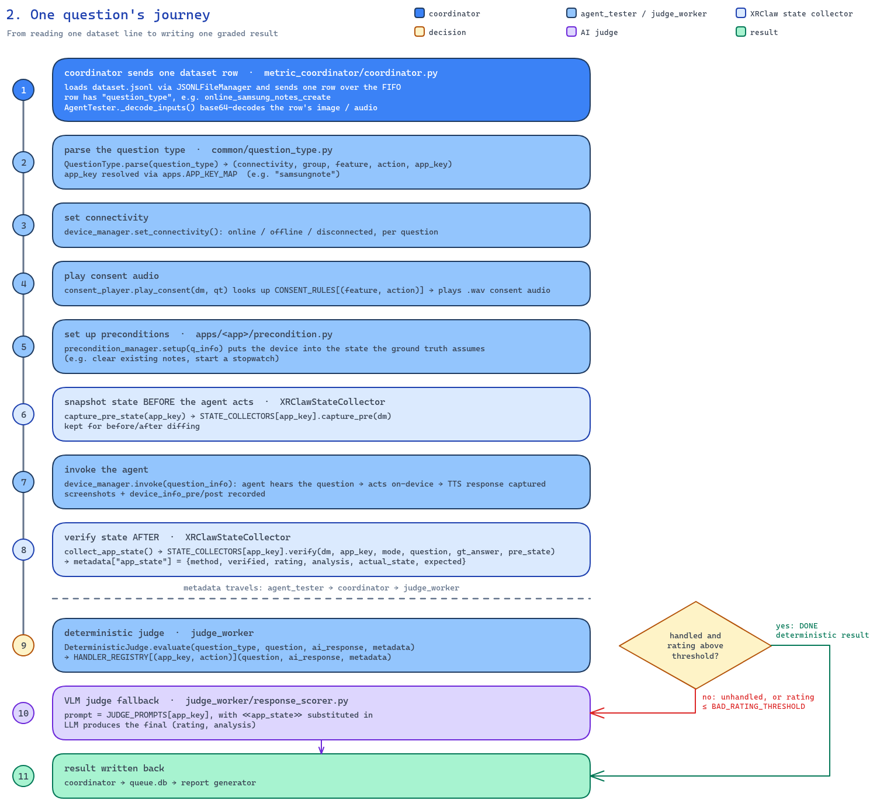
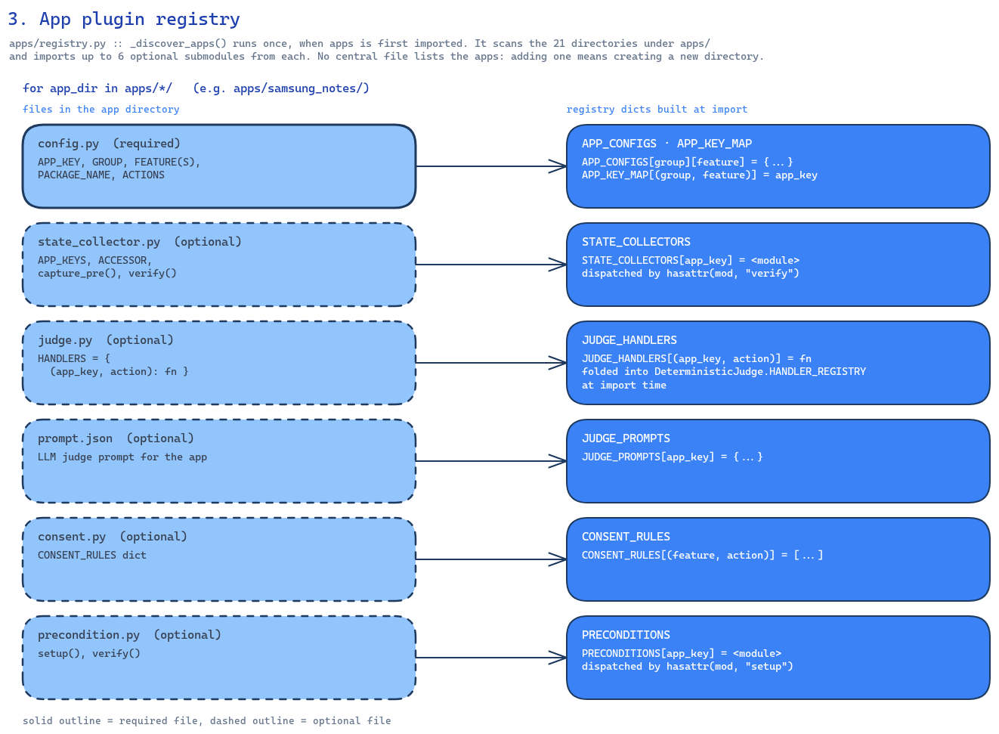
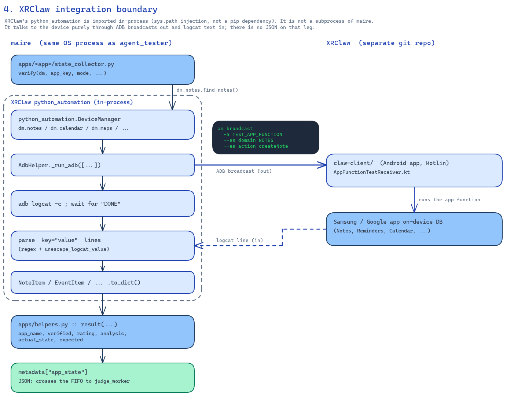

# Evaluation Framework

Automated evaluation framework for testing multimodal AI agents on devices with support for live mode testing, transcription services, and automated judging.

---

## Overview



<sub>Editable source: [overview.excalidraw](./docs/diagrams/overview.excalidraw)</sub>

---

## Quick Start

```bash
# 1. Install dependencies
pip install -r requirements.txt

# 2. Configure evaluation (copy and modify template)

# 3. Start required services (Judge Model, Transcription, Display Client)

# 4. Run the evaluation
python -m automator.automator ./configs/your_config.json
```
The automator manages two screen sessions (`agent_tester` and `judge_worker`). 
---

## Hierarchical Question Type Format

All evaluation queries use a **4-part hierarchical question type** format:

```
<connectivity>_<group>_<feature>_<action>
```

| Part | Description | Examples |
|------|-------------|----------|
| `connectivity` | Network/device connectivity state | `online`, `offline`, `disconnected`, `etc` |
| `group` | App vendor or device-level group | `samsung`, `google`, `thirdparty`, `device`, `etc` |
| `feature` | App name or device feature | `notes`, `keep`, `battery`, `volume`, `clock_timer`, `etc` |
| `action` | Specific operation to evaluate | `create`, `launch`, `up`, `companion`, `play` , `etc` |

### Examples

```
online_samsung_notes_create        → Samsung Notes, create a note, online mode
offline_device_battery_glasses     → Jinju glasses battery, offline mode 
online_device_battery_companion    → Companion phone battery, online mode
online_device_volume_up            → Increase volume, online mode
online_samsung_clock_timer_create  → Samsung Clock , create timer
online_thirdparty_spotify_play     → Spotify, play music
```

### Why Hierarchical?

The old flat format (e.g. `device_online_battery`) was ambiguous — it couldn't distinguish which device's battery to query, what connectivity state to set, or which app group a feature belonged to. The 4-part format solves this by:

1. **Connectivity as a first-class dimension** — The first part (`online`/`offline`/`disconnected`) controls WiFi, mobile data, and Bluetooth state on the companion device before each query. This enables testing the agent's behavior under different network conditions.

2. **Structured routing** — The framework parses the question type to automatically determine:
   - Which device to interact with (Jinju glasses vs. companion phone)
   - Which app to launch and what tasks to perform (`common/question_type.py` → `apps/registry.py::get_task_list()`)
   - Which deterministic judge handler to invoke (`deterministic_judge.py` → `HANDLER_REGISTRY`)
   - Which app key an app_key-keyed lookup should use (`apps/registry.py::get_app_key()`)

3. **Compound features** — Some features span multiple words (e.g. `clock_timer`, `clock_alarm`, `clock_stopwatch`). `QuestionType.parse()` in `common/question_type.py` handles this by checking if `parts[2]_parts[3]` matches a known compound feature before falling back to a 4-part parse.

4. **Legacy app keys** — `apps/registry.py::APP_KEY_MAP` bridges the hierarchical format to legacy XRClaw app keys (e.g. `("samsung", "notes")` → `"samsungnote"`), so XRClaw code doesn't need to change.

### Connectivity Modes

| Mode | WiFi | Mobile Data | Bluetooth | Use Case |
|------|------|-------------|-----------|----------|
| `online` | ON | ON | ON | Normal operation |
| `offline` | OFF | OFF | ON | No internet (Glasses are still paired) |
| `disconnected` | ON | ON | OFF | Internet but no BT connection to glasses |

### Key Files

| File | Role |
|------|------|
| `apps/registry.py` | `APP_CONFIGS`, `STATE_COLLECTORS`, `JUDGE_HANDLERS`, `JUDGE_PROMPTS`, `CONSENT_RULES`, `PRECONDITIONS` — auto-discovers all apps in `apps/*/` |
| `apps/{app}/judge.py` | `HANDLERS` dict maps `(app_key, action)` → handler function (auto-registered) |
| `apps/{app}/state_collector.py` | `capture_pre(dm)`, `verify(dm, ...)` — app state collection |
| `apps/{app}/config.py` | `PACKAGE_NAME`, `ACTIVITY_NAME`, `ACTIONS` — app configuration |
| `apps/judge_helpers.py` | Shared helper functions: `handle_launch()`, `handle_app_state()`, `handle_camera()`, `handle_video()` |
| `judge_worker/deterministic_judge.py` | `DeterministicJudge` class — routes to handlers via `JUDGE_HANDLERS`, falls back to VLM |

---

## State Collector — Registry-Based App State Collection

The framework uses a **registry-based plugin system** for programmatic app state collection during `APP_EVAL_TASK` evaluations. Each app has its own state collector module that queries actual app databases directly — no screenshots, no LLM judge needed for supported apps.

### Plugin Registry Architecture

The app registry (`apps/registry.py`) auto-discovers all app subdirectories and builds global registries:

- `APP_CONFIGS[group][feature]` — {package_name, activity_name, actions}
- `APP_KEY_MAP[(group, feature)]` — app_key
- `STATE_COLLECTORS` — {app_key → state_collector module}
- `JUDGE_HANDLERS` — {(app_key, action) → handler function}
- `JUDGE_PROMPTS` — {app_key → prompt dict}
- `CONSENT_RULES` — {(feature, action) → [(wav, pause, wait), ...]}
- `PRECONDITIONS` — {app_key → precondition module}

Each app directory exports (all but `config.py` are optional):
- `config.py` — `APP_KEY`, `GROUP`, `FEATURE` (or `FEATURES`), `PACKAGE_NAME`, `ACTIVITY_NAME`, `ACTIONS`
- `state_collector.py` — `APP_KEYS`, `capture_pre(dm)`, `verify(dm, ...)`
- `judge.py` — `HANDLERS` dict + handler functions
- `prompt.json` — LLM judge prompt (string, dict, list, or a `{"type": "dynamic", ...}` device lambda)
- `consent.py` — `CONSENT_RULES` dict
- `precondition.py` — `setup(dm, sc, qt, question, gt_answer)`

### XRClawStateCollector — Thin Wrapper

The `XRClawStateCollector` (in `agent_testers/device_managers/xrclaw_state_collector.py`, ~225 lines) is a **thin wrapper** that:
1. Initializes the XRClaw `DeviceManager`
2. Provides foreground detection with ADB fallback
3. Delegates all app-specific logic to registry modules via `STATE_COLLECTORS`

```python
# Registry dispatch in XRClawStateCollector.collect_app_state()
mod = STATE_COLLECTORS.get(app_name)
if mod and hasattr(mod, "verify"):
    return mod.verify(self._dm, app_mode, question, gt_answer, pre_state)
```

> **Design decision:** The core framework interacts only with the `StateCollector` interface. XRClaw is the first implementation. Future plugins (e.g. UI-automation-based collectors) can implement the same interface and be dropped in without core changes.

### How It Works

1. **Before the agent acts**: `capture_pre_state(app_name)` dispatches to the app's `capture_pre(dm)` module
2. **Agent executes the query** on the device
3. **After the agent acts**: `collect_app_state()` dispatches to the app's `verify(dm, ...)` module
4. **Result**: App-specific state with rating (0-5) and analysis
5. **Judge worker**: `DeterministicJudge` reads the collected state and produces the final rating. If the rating is too low, falls back to VLM (LLM) judge.

### Configuration

Add the `xrclaw` section to your config JSON:

```json
{
    "xrclaw": {
        "enabled": true,
        "python_automation_path": "/path/to/XRClaw/python_automation",
        "claw_package": "com.samsung.xr.claw.client"
    }
}
```

The XRClaw state collector runs on the companion device (identified by `s25_device_id` in the config).

### Supported Apps

| App Key | App | State Collection Method |
|---------|-----|-------------------------|
| `samsung_notes` | Samsung Notes | Content provider query |
| `samsung_reminders` | Samsung Reminders | Reminders provider query |
| `samsung_calendar` | Samsung Calendar | Calendar events query |
| `google_calendar` | Google Calendar | Calendar events query |
| `google_keep` | Google Keep | Content provider query |
| `google_mail` | Gmail | Content provider query |
| `google_tasks` | Google Tasks | Tasks provider query |
| `google_maps` | Google Maps | Navigation state |
| `google_translate` | Google Translate | Logcat parsing |
| `google_youtube_music` | YouTube Music | Media playback state |
| `thirdparty_spotify` | Spotify | Media playback state |
| `thirdparty_whatsapp` | WhatsApp | Content provider query |
| `samsung_call` | Samsung Call | Call state |
| `samsung_camera` | Samsung Camera | Logcat parsing |
| `samsung_message` | Samsung Messages | SMS provider query |
| `samsung_voicerecorder` | Samsung Voice Recorder | File system query |
| `samsung_clock` | Samsung Clock | Alarm/Timer/Stopwatch state |
| `samsung_clock_alarm` | Samsung Clock Alarm | Alarm database |
| `samsung_clock_timer` | Samsung Clock Timer | Timer state |
| `samsung_clock_stopwatch` | Samsung Clock Stopwatch | Stopwatch state |
| `device` | Device Info | Battery/time/volume/DND/media |

### Adding New Apps

To add a new app to the framework:

1. **Create directory** `apps/{app_name}/`

2. **Add these files:**

   **`config.py`** — App metadata + configuration:
   ```python
   APP_KEY = "my_app"
   GROUP = "thirdparty"
   FEATURE = "myapp"

   PACKAGE_NAME = "com.example.myapp"
   ACTIVITY_NAME = ".MainActivity"
   ACTIONS = {
       "launch": [
           ["open_app"],
           ["screenshot"],
           ["close_app"]
       ],
       "create": [
           ["open_app"],
           ["click", 400, 1200],  # x, y coordinates
           ["screenshot"],
           ["close_app"]
       ],
       # Task types: ["open_app"], ["click", x, y], ["screenshot"], ["close_app"],
       #              ["swipe", x1, y1, x2, y2], ["back"], ["wait", seconds]
       # These are executed via ADB commands (not XRClaw AppFunctions)
       # XRClaw AppFunctions (dm.notes.find_notes(), etc.) are used ONLY by
       # state_collector.py for verification, NOT for task execution
   }
   ```

   **`state_collector.py`** — State collection logic:
   ```python
   from apps.helpers import result, unsupported_result, error_result

   APP_KEYS = ("my_app",)

   def capture_pre(dm):
       """Snapshot app state before agent acts."""
       # Use XRClaw AppFunctions to query app database
       # Example: notes = dm.notes.find_notes()
       #          return {"notes": [n.to_dict() for n in notes], "count": len(notes)}
       
       # OR return empty dict if app doesn't have XRClaw support
       # (app will fall back to screenshot + VLM judge)
       return {}

   def verify(dm, app_key, mode, question, gt_answer, pre_state=None):
       """Verify agent's action succeeded."""
       # For apps with XRClaw support: compare pre vs post state
       # For apps without: return unsupported_result(app_key, gt_answer)
       return result("my_app", verified=True, rating=5, analysis="...", actual_state=..., expected=gt_answer)
   ```

   **`judge.py`** — Deterministic judge handlers (auto-registered via `JUDGE_HANDLERS`):
   ```python
   from apps.judge_helpers import handle_launch, handle_app_state

   HANDLERS = {
       ("my_app", "launch"): handle_launch,
       ("my_app", "create"): handle_app_state,
   }
   ```

   **`prompt.json`** — VLM judge prompt (optional):
   ```json
   {
     "launch": "Evaluate whether the app was launched successfully...",
     "create": "Evaluate whether the item was created..."
   }
   ```

   **`consent.py`** — Consent rules (optional):
   ```python
   CONSENT_RULES = {
       ("myapp", "create"): [("consent.wav", 500, 1000)],
   }
   ```

   **`precondition.py`** — Preconditions setup (optional):
   ```python
   from apps.precondition_helpers import report

   def setup(dm, sc, qt, question, gt_answer) -> dict:
       """Put the device into the state gt_answer assumes, before the agent acts.

       dm: DeviceManager. sc: state collector (or None). qt: parsed QuestionType.
       """
       return report(passed=True, set_items=["precondition1"])
   ```

3. **That's it!** The registry auto-discovers the app on import. No manual registration needed — handlers are automatically added to `JUDGE_HANDLERS` via `apps/registry.py`.

### Installing the XRClaw App

A pre-built debug APK is included in the `assets/` folder. Install it on the companion device:

```bash
# Install the pre-built APK
adb -s <DEVICE_ID> install -r assets/claw-client-debug.apk

# Launch with privileged permissions (required for App Functions)
adb -s <DEVICE_ID> shell am force-stop com.samsung.xr.claw.client
adb -s <DEVICE_ID> shell am instrument -w com.samsung.xr.claw.client/.ShellIdentityInstrumentation
```

> **Important:** The app must be launched via `ShellIdentityInstrumentation` to receive privileged permissions. Opening it from the launcher will NOT work.

### Testing XRClaw App Functions

```bash
cd /path/to/XRClaw
source /path/to/your/virtualenv/bin/activate

python -c "
from python_automation import DeviceManager
dm = DeviceManager(adb_path='adb', device='DEVICE_ID')

# Query app state
notes = dm.notes.find_notes()
print(f'Notes: {len(notes)}')

# Execute app functions
dm.notes.create_note(title='Test', content='Hello')
dm.stopwatch.start_stopwatch()
dm.reminders.create_reminder(title='Test Reminder')

# Device info
info = dm.device_info.get_all()
print(f'Battery: {info.to_dict()[\"battery\"][\"level\"]}%')
"
```

### Fallback Behavior

| Condition | Method Value | Judge Used |
|-----------|--------------|------------|
| XRClaw disabled | N/A | Screenshot + VLM |
| App unsupported | `xrclaw_unsupported` | Screenshot + VLM |
| XRClaw error | `xrclaw_error` | Screenshot + VLM |
| Normal verification | `xrclaw` | Deterministic |
| Read query | `xrclaw_read` | Deterministic (base rating) + optional VLM for content accuracy |
| XRClaw unavailable (e.g., Maps query mode) | `xrclaw_unavailable` | VLM with gt_answer as ground truth |


---

## Pre-Run Checks

**`scripts/pre_run_checks.py`** is a diagnostic script that validates the entire environment before running the evaluation pipeline. It catches common issues early — device connectivity, ARAP app, XRClaw, services, config — so you don't waste time debugging mid-run failures.

### Usage

```bash
# Run all checks
python scripts/pre_run_checks.py configs/your_config.json

# Skip specific checks
python scripts/pre_run_checks.py configs/your_config.json --skip-arap    # skip ARAP device tests
python scripts/pre_run_checks.py configs/your_config.json --skip-xrclaw  # skip XRClaw tests
```

**Exit codes:** `0` = all checks passed, `1` = one or more checks failed.

### Check Categories

| # | Category | What It Checks | Failure Action |
|---|----------|---------------|----------------|
| 1 | **Config Validation** | Config JSON is valid, all required sections present (`device_manager_type`, `paths`, `devices`, `urls`, `judge_worker`, `automator`), device IDs non-empty, ARAP config valid | Fix config before proceeding |
| 2 | **Dataset Validation** | Dataset file exists, is valid JSONL, non-empty, and index range is within bounds | Fix dataset path or indices |
| 3 | **Device Connectivity** | All configured devices (S25, Jinju, ARAP) are online via `adb get-state` | Connect devices via USB/wireless ADB |
| 4 | **ARAP App** | `com.ss.arap` is installed, launchable, can play audio (push WAV → broadcast → check logcat), and can record (start → stop → pull file → verify size). If `use_robohead=true`, checks Robopod server reachability instead | Install ARAP APK or fix Robopod URL |
| 5 | **XRClaw** | XRClaw app is running with `ShellIdentityInstrumentation` (privileged permissions), and app functions respond (queries `device_info.get_all()` and `notes.find_notes()`) | Relaunch XRClaw via `am instrument` |
| 6 | **Services** | Transcription service reachable at `/health/`, judge model reachable at `/models`, display client process running | Start missing services |
| 7 | **Python Dependencies** | `requests`, `openai`, `numpy` are importable | `pip install` missing packages |
| 8 | **FireRedVAD** | `fireredvad` package importable, model directory exists at `data/models/fireredvad/pretrained_models/FireRedVAD/VAD`, and key files (`cmvn.ark`, `model.pth.tar`) present | Install package + download model files |
| 9 | **Optional Services** | Rating rectifier service reachable (if configured). **Warning only** — pipeline works without it | Non-blocking |


---

## Running Tests

The framework includes a comprehensive test suite under `test/`. All tests use `pytest`.

### Running Tests

```bash
# Activate the environment with pytest
source /path/to/your/virtualenv/bin/activate


# Run the full smoke test suite (all tests)
bash scripts/run_smoke_test.sh

# Run a specific test file
python -m pytest test/test_config_schema.py -v

```

### Test Files

| Test File | What It Tests |
|-----------|---------------|
| `test/test_config_schema.py` | Config JSON schema validation (required fields, types, device IDs) |
| `test/test_entropy.py` | Entropy metrics computation (entropy, surprisal, curvature) |
| `test/test_message.py` | Message handling (SMS, WhatsApp send/receive verification) |
| `test/test_response_scorer_scoring.py` | Response scorer rating logic (QA, VQA, hallucination tasks) |


### Scripts

| Script | Description |
|--------|-------------|
| `scripts/run_smoke_test.sh` | Runs the full pytest smoke test suite |
| `scripts/pre_run_checks.py` | Pre-run diagnostic checks (see [Pre-Run Checks](#pre-run-checks)) |
| `scripts/power_measure_jinju.sh` | On-device power measurement script (pushed to Jinju during eval) |


---

## Architecture Overview

For a detailed system design document, see [docs/ARCHITECTURE.md](./docs/ARCHITECTURE.md).

The [overview](#overview) above is the short version. The full system diagram below shows every component and where each numbered step of a question's journey runs (click for full size):

[](./docs/diagrams/system-detailed.png)

<sub>Editable source: [system-detailed.excalidraw](./docs/diagrams/system-detailed.excalidraw)</sub>

> **Note:** The current implementation uses a **registry-based plugin system** where each app has its own state collector, judge, and prompt modules in top-level `apps/{app_name}/` (not `agent_testers/apps/`). The `XRClawStateCollector` is now a thin wrapper that delegates to these per-app modules via the `STATE_COLLECTORS` registry. The four diagrams below reflect the current design.

### 1. Process Topology

Four OS processes, wired by named pipes (FIFOs) in `/tmp`, each frame a 4-byte length
header + JSON payload (`utils/message_transport.py::MessagePipes`). `automator.py` starts
XRClaw instrumentation on the companion device, then spawns the other three:



<sub>Editable source: [process-topology.excalidraw](./docs/diagrams/process-topology.excalidraw)</sub>

Note: `agent_tester` and `judge_worker` never talk to each other directly. `app_state`
rides inside `metadata`, which the coordinator forwards from one FIFO pair to the other.

### 2. One Question's Journey

What happens between reading one line of the dataset and writing one graded result:



<sub>Editable source: [question-journey.excalidraw](./docs/diagrams/question-journey.excalidraw)</sub>

### 3. App Plugin Registry

`apps/registry.py :: _discover_apps()` runs once, when `apps` is first imported. It scans
the 21 sibling directories under `apps/` and, for each, imports up to 6 optional
submodules — no central file lists the apps; adding one means creating a new directory:



<sub>Editable source: [app-registry.excalidraw](./docs/diagrams/app-registry.excalidraw)</sub>

### 4. XRClaw Integration Boundary

XRClaw's `python_automation` is imported in-process (via `sys.path` injection, not a
pip dependency) — it is not a subprocess of maire. XRClaw itself talks to the device
purely through ADB broadcasts out and logcat text in; there is no JSON on that leg:



<sub>Editable source: [xrclaw-boundary.excalidraw](./docs/diagrams/xrclaw-boundary.excalidraw)</sub>

---

## Prerequisites

### 1. Python Dependencies

```bash
pip install -r requirements.txt
```

### 2. Judge Model

Host your judge model via OpenAI-compatible API. Currently using [Qwen-3.6-int4](https://huggingface.co/Intel/Qwen3.6-27B-int4-AutoRound).

### 3. Transcription Service

Host `services/host/transcription_server.py` (default port 8080).

### 4. FireRedVAD (speech detection)

Download [model files](https://huggingface.co/FireRedTeam/FireRedVAD/tree/main) to `data/models/fireredvad/pretrained_models/FireRedVAD`.

### 5. Display Client

```bash
python services/client/display_client_portrait.py http://<host>:<port>
```

### 6. Robotester Server [OPTIONAL]

Host `services/host/arap_service.py` on the Robotester machine for audio recording/playback.

---

## Configuration Reference

### Top-level Configuration

| Key | Type | Description | Example |
|-----|------|-------------|---------|
| `device_manager_type` | string | Device manager type | `"jinju-gemini"`, `"s25-gemini-live"` |
| `dataset_start_index` | integer | Starting dataset index | `0` |
| `dataset_end_index` | integer | Ending dataset index | `10000` |

**Device manager types** (see `agent_testers/device_managers/DEVICE_MANAGERS`):
- `"jinju-gemini"` — Jinju glasses + Gemini Live (the primary path)
- `"s25-gemini-live"` — S25 phone + Gemini Live
- `"dummy-device-manager"` — no-op manager for pipeline testing without hardware

### Logger Configuration

| Key | Type | Description | Default |
|-----|------|-------------|---------|
| `dump_device_logs` | boolean | Dump device logs for debugging | `true` |
| `logger_level` | string | Log level | `"debug"` |

### Power Measurement (Jinju only)

Requires `logger.dump_device_logs: true`. Runs a background sampler on-device during the evaluation window.

| Key | Type | Description | Default |
|-----|------|-------------|---------|
| `enabled` | boolean | Enable power measurement | `false` |
| `script_path` | string | On-device measurement script | `"scripts/power_measure_jinju.sh"` |
| `samples` | integer | Number of samples (killed at window boundary) | `100000` |
| `interval` | integer | Sampling interval (seconds) | `2` |

### Paths Configuration

| Key | Type | Description | Example |
|-----|------|-------------|---------|
| `dataset_file` | string | Dataset file (JSONL) | `"data/dataset.jsonl"` |
| `root_folder` | string | Results root folder | `"results/run_001"` |
| `queue_file` | string | SQLite queue database | `"metric_coordinator/queue.db"` |
| `queue_backup_folder` | string | Queue backup folder | `"backups/queue"` |
| `backup_folder_path` | string | [OPTIONAL] Additional backup path | `"shared_storage/backups"` |

### Devices Configuration

| Key | Type | Description | Example |
|-----|------|-------------|---------|
| `s25_device_id` | string | S25 device serial | `"ABC123XYZ"` |
| `jinju_device_id` | string | Jinju device ID | `"JINJU001"` |
| `arap` | object | ARAP (Audio Recording and Playback) config | See below |

#### ARAP Configuration

| Key | Type | Description | Default |
|-----|------|-------------|---------|
| `use_robohead` | boolean | Use Robohead for audio | `true` |
| `robopod_url` | string | Robopod server URL | `"http://robotester:8000"` |
| `record_duration` | integer | Recording duration (seconds) | `25` |
| `devices` | array | Device IDs (first=speaker, second=listener) | `["dev1", "dev2"]` |

### URLs Configuration

| Key | Type | Description | Example |
|-----|------|-------------|---------|
| `transcription_url` | string | Transcription service URL | `"http://host:8080"` |
| `judge_url` | string | Judge model API URL | `"http://host:8282/v1"` |
| `display_port` | integer | Display client port | `5000` |

### Judge Worker Configuration

| Key | Type | Description | Default |
|-----|------|-------------|---------|
| `vllm_api` | boolean | Judge uses vLLM API | `true` |
| `qa_prompt_version` | string | QA prompt version | `"1.0"` |
| `vqa_prompt_version` | string | VQA prompt version | `"2.0"` |
| `hqa_prompt_version` | string | HQA prompt version | `"1.0"` |

### Automator Configuration

| Key | Type | Description | Default |
|-----|------|-------------|---------|
| `num_evaluations` | integer | Evaluation rounds before stopping retries | `1` |
| `postprocess_only` | boolean | Run only post-processing | `false` |
| `generate_reports` | boolean | Generate `vqa_report.jsonl` | `true` |

### XR Board Configuration

| Key | Type | Description | Example |
|-----|------|-------------|---------|
| `generate_reports` | boolean | Generate XR Board reports | `true` |
| `upload_files` | boolean | Upload files to XR Board | `true` |
| `user_id` | string | XR Board user ID | `"user123"` |
| `companion_pair` | string | Device/AI model identifier | `"s25/gemini-live"` |
| `kpi_type` | string | KPI metrics type | `"multimodal"` |
| `dataset_name` | string | Dataset name | `"eval_v1"` |
| `judge_name` | string | Judge model name | `"Qwen-3.5-27B"` |

### Example Configuration Files

| File | Description |
|------|-------------|
| `configs/jinju_gemini_config.json` | Jinju + Gemini |
| `configs/s25_gemini_live_config.json` | S25 + Gemini Live |

---

## Logcat Analysis Framework

Pattern-based logcat analysis for detecting camera and video capture events.

- **`utils/log_analyzer.py`** — Core analyzer with `LogcatAnalyzer` class
- **`utils/test_log_analyzer.py`** — Test script

### Camera/Video Patterns

| Pattern | Matches | Description |
|---|---|---|
| `image_captured` | `onPhotoCaptured` | Photo saved to disk |
| `video_captured` | `onVideoCaptured` | Video saved to disk |
| `photo_uri` | `content://` URI in `onPhotoCaptured` | Saved photo URI |
| `video_uri` | `content://` URI in `onVideoCaptured` | Saved video URI |

```bash
# Test against a log file
python -m utils.test_log_analyzer /path/to/logcat.txt

# Live test against a connected device
python -m utils.test_log_analyzer --live <device_id> --duration 30
```

---

## Device Query Evaluation

Device queries use the hierarchical question type format (see [Hierarchical Question Type Format](#hierarchical-question-type-format)). The `<connectivity>` part (e.g. `online`, `offline`, `disconnected`) is omitted from the table below for brevity.

| Query Type | Question Type Format | Evaluation Method |
|---|---|---|
| Battery (Glasses) | `<conn>_device_battery_glasses` | Compare vs `jinju.battery.level` (±2%) |
| Battery (Phone) | `<conn>_device_battery_phone` | Compare vs `jinju.battery.level` (±2%) |
| Battery (Companion) | `<conn>_device_battery_companion` | Compare vs `companion.battery.level` (±2%) |
| Time | `<conn>_device_datetime_time` | Compare vs `jinju.time` (±60s) |
| Date | `<conn>_device_datetime_date` | Compare vs `jinju.date` |
| Volume Up | `<conn>_device_volume_up` | Verify volume increased (pre vs post, any stream) |
| Volume Down | `<conn>_device_volume_down` | Verify volume decreased (pre vs post, any stream) |
| Volume Set | `<conn>_device_volume_set` | Verify volume matches target level (any stream) |
| DND On | `<conn>_device_dnd_on` | Verify DND turned on (pre vs post) |
| DND Off | `<conn>_device_dnd_off` | Verify DND turned off (pre vs post) |
| Camera | `<conn>_device_camera_click` | `jinju_image_captured` flag from logcat |
| Video Start | `<conn>_device_camera_videostart` | `jinju_video_captured` flag from logcat |
| Video Stop | `<conn>_device_camera_videostop` | `jinju_video_captured` flag from logcat |
| Media Play | `<conn>_device_mediacontrol_play` | Compare media pre vs post state |
| Media Pause | `<conn>_device_mediacontrol_pause` | Compare media pre vs post state |
| Media Skip | `<conn>_device_mediacontrol_skip` | Position reset or advanced >30s |
| Media Replay | `<conn>_device_mediacontrol_replay` | Position moved backward |
| Notifications | `<conn>_device_notification_read` | Screenshot of notification panel |


### Volume Evaluation — Multi-Stream Tracking

Volume evaluation tracks **all Android audio streams** (MUSIC, RING, ALARM, NOTIFICATION, etc.) on **both** the Jinju glasses and the companion phone, not just STREAM_MUSIC. This ensures volume changes are detected regardless of which stream the agent actually modifies.

#### How it works

1. **State collection** — `DeviceInfo.get_volume()` parses every `STREAM_*` section from `dumpsys audio`, returning an `all_streams` dict with `{min, max, current}` per stream. Both Jinju and companion device volumes are captured.

2. **Precondition setup** (`apps/device/precondition.py::_setup_volume()`) — Before each volume query, all streams on the Jinju device are set to a known starting level using **percentage-based targets** relative to each stream's max:

   | Action | Direction | Target (per stream) | Purpose |
   |--------|-----------|---------------------|---------|
   | `up` / `uprelative` | low | `max(1, int(0.1 * smax))` | Near min — agent can increase |
   | `down` / `downrelative` | high | `int(0.9 * smax)` | Near max — agent can decrease |
   | `mute` | mid | `int(0.5 * smax)` | Mid level, unmuted |
   | `unmute` | zero | `0` | Muted |

3. **Global reset** (`reset_media_volume()`) — Before every test case, volume is reset to **80% of each stream's max** across all streams on the target device. This replaces the old behavior of setting only STREAM_MUSIC to an absolute index of 70 (which was silently clamped to max=15).

4. **Deterministic judge** (`apps/device/judge_rules.py::handle_volume()`) — Compares pre vs post volume across all streams from both devices. The test **passes if any stream** on either device shows the expected change. This handles cases where the agent changes a different stream than expected (e.g. RING instead of MUSIC).

5. **Adaptive threshold** — Instead of a fixed threshold, the allowed delta is computed per stream as `max(1, (max - min) // 10)`. This adapts to different stream ranges:
   - Jinju MUSIC (0–15) → threshold = 1
   - Companion MUSIC (0–15) → threshold = 1
   - A stream with range 0–100 → threshold = 10

6. **Reasoning filtering** — The judge's reasoning text only mentions streams that actually changed (Δ≠0 for up/down, matched target or closest for set, muted/umuted transitions for mute/unmute), reducing noise in the rating explanation.

#### Key files

| File | Role |
|------|------|
| `agent_testers/device_managers/adb_device_info.py` | `DeviceInfo.get_volume()` — parses all `STREAM_*` from `dumpsys audio` |
| `agent_testers/device_managers/jinju_gemini_manager.py` | `reset_media_volume()` — sets all streams to percentage of max |
| `apps/device/precondition.py` | `_setup_volume()` — per-action starting levels (percentage-based) |
| `apps/device/judge_rules.py` | `handle_volume()` — multi-stream, any-passes, adaptive threshold |
| `judge_worker/device_info_filter.py` | `_format_volume()` — emits `<stream name="...">` XML elements |
| `XRClaw/python_automation/apps/device_info_app.py` | `VolumeState` with `all_streams` for XRClaw path |


### Disable keyboard pop-up
adb -s <device-id> shell settings put secure default_input_method nothing


## Live Dashboard

python3 scripts/eval_dashboard.py --db metric_coordinator/queue.db --port 5055

Can be browsed from another machine:
http://107.99.239.59:5055/

---

## License

© 2024 Samsung Research. All rights reserved.
